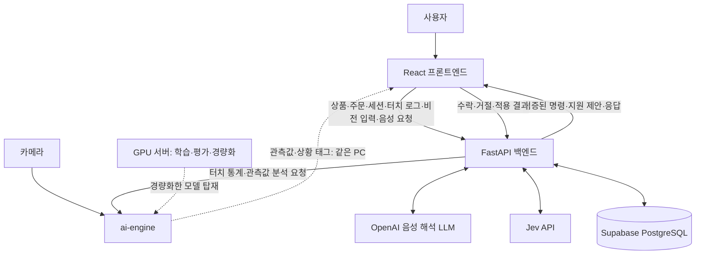

# AI 기반 적응형 매장 키오스크

컴퓨터 비전과 터치 통계로 사용 상황을 읽고, backend가 Jev 판단을 바탕으로 접근성 지원의 때와 방식을 고르는 소형 매장 주문 키오스크를 목표로 합니다.

현재 프론트엔드는 상품 그림·쪽 넘김을 사용하는 터치 주문 화면과 큰 글씨·큰 버튼·간편 화면·낮은 화면·단계별 안내·고대비를 제공합니다. 음성 주문 후 서버 장바구니 재조회, 기본 터치 통계 전송, 수락 후 설정을 적용하는 비모달 지원 안내 바를 연결했습니다. 자동 음성 응답 읽기는 PR #79에서 검토 중이며, 실제 AI 지원 생성·음성 UI 조작·G10 최종 검증은 남아 있습니다.

> 현재 설계 및 개발 단계입니다. 구현·검증 상태는 아래 표에서 확인하고, 시스템 아키텍처와 자동 지원 흐름은 목표 구성으로 읽어 주세요. 높은 화면 모드는 현재 구현 범위에서 제외합니다.

처음 읽는 분께: ① 프로젝트가 무엇인지는 이 문서의 '프로젝트 목표'와 '시스템 아키텍처', ② 지금 어디까지 됐는지는 '현재 구현 상태' 표(날짜·담당·문서 링크), ③ 다음 날짜는 '일정', ④ 낯선 말은 '용어'를 보세요. 부분별 세부 상태는 각 폴더의 README이고, 팀 검토 문서는 `docs/*-Review.md`·`docs/*-Implementation.md`, 인터페이스 형식과 합의 상태는 `contract/`에서 확인합니다(음성 명세와 신규 주문 API는 팀 검토용 초안).

## 현재 구현 상태 (2026-10-14 갱신; 컴퓨터 비전 행은 2026-10-23, 프론트엔드 행은 2026-11-20)

| 부분 | 담당(GitHub) | 상태 | 자세한 문서 |
|---|---|---|---|
| 프론트엔드 | dudwlghkd | main `9317b0b` 기준 상품·장바구니·모의 주문, 수동 접근성, 음성 결과의 Cart 재조회(PR #71), 기본 터치 통계와 선택적 확장 전송(PR #72), 키오스크 화면 개편·비모달 지원 안내 바(PR #70)를 반영했습니다. 기존 화면의 개발 PC 실제 음성 주문·DB 저장은 2026-11-16에 1건 검증했습니다. #70 개편 화면·#79 자동 TTS 조합의 실연동 재검증과 실제 AI 제안 생성·G10 검증은 남아 있습니다 | [프론트엔드 README](frontend/README.md), [프론트 MVP 현황](docs/Frontend-MVP-Status.md) |
| 백엔드·DB | bb-cloud-create | 연결 확인·임시 세션·특징 전송 API를 구현했습니다(메모리 세션). 상품·장바구니·모의 주문 6개 API는 PR #40에서 초안 기준으로 구현했습니다(메모리 저장). 2026-10-14 Docker에서 실제 프론트를 연결한 주요 주문 흐름·응답 유실 재확인을 검증했습니다. G10 실기기·음성·DB 영속성 검증과 남은 계약·정책 합의는 남아 있습니다. Supabase 첫 마이그레이션을 적용했습니다(2026-10-07) | `backend/README.md`, `db/README.md` |
| ai-engine·음성·Jev | jiwon-L-ee | `/v1/analyze`는 명세 예시 값을 돌려주는 자리 표시입니다. backend의 음성 해석 API(PR #36)와 frontend 독립 음성 입력·잡담 거르기(`ignored`)·해석용 주문 메뉴 조회(PR #42)를 병합했습니다. 주문 화면 연결·MCP 도구 실행은 남아 있으며 Jev는 아직 연동하지 않았습니다 | `ai-engine/README.md`, `docs/Voice-MCP-Implementation.md` |
| 컴퓨터 비전 | wdragon92 | 관측 뼈대(PR #32, 2026-10-10)와 상황 태그 3개의 규칙 · 출력 형식(PR #35, 2026-10-12)을 병합했습니다. 실행 파이프라인(녹화 재생 · 웹캠 실행기 → 상황 태그 → 규칙표 v0 → 계약 형식)과 머리 탐지기 · 머리 방향 분류기의 ONNX CPU 추론을 구현했습니다(2026-10-23, `feat/vision`; 병합은 PR 검토 뒤). 기준값은 모두 `[파일럿]`이고 값 묶음 파일은 아직 없으며, backend와의 연결은 없습니다. GPU 서버에서 머리 탐지기(2026-10-12)와 머리 방향 분류기(2026-10-14)를 학습했고, 구간 모델 baseline(FACT 끝, ASFormer 진행 중)을 돌리고 있습니다 | `ai-engine/app/modules/vision/README.md` |
| 인프라 | bb-cloud-create | EC2 템플릿을 검증했습니다(PR #31). 스택은 비용 승인 전이라 만들지 않았습니다 | `infra/aws/README.md` |

상태어: 구현됨 / 준비됨(서버 미연결) / 자리 표시 / 제안(팀 검토 전) / 보류 / 미정. 이 표에서는 이 여섯 말을 이 뜻으로만 씁니다.

### 프론트엔드 구현·검증 범위

2026-11-20 확인한 main `9317b0b`의 프론트 상태입니다. PR #70·#71·#72의 병합 결과와, 아직 병합하지 않은 PR #79·#87의 작업을 구분합니다. 다른 담당 영역의 현황은 이 갱신에 포함하지 않습니다.

| 기능 | 현재 상태 |
|---|---|
| 상품·장바구니·모의 주문 | 상품 그림·분류·쪽 넘김, 옵션 창, 장바구니 전체 보기, 주문 확인·완료·서버 주문번호 표시를 제공합니다. [주문하기]·[새 주문 시작]은 하단 주문 바에 두며 실제 결제·재고 차감은 연결하지 않았습니다 |
| 주문 요청·오류 처리 | 성공 응답 뒤 수량·금액 확정, 요청 중 변경 차단, 버전 충돌 시 최신 장바구니 표시, 응답 유실 시 같은 키·본문의 수동 재시도를 구현했습니다 |
| 수동 접근성 | 큰 글씨(200%)·큰 버튼·간편 화면·단계별 안내·낮은 화면·고대비를 화면 도움 창에서 바꿉니다. 낮은 화면의 위쪽 [화면 위로 올리기]로 높이만 되돌릴 수 있습니다 |
| 새 주문·설정 유지 | 새 주문·새로고침은 새 서버 세션·빈 장바구니로 시작합니다. 수동 접근성 설정은 로컬에 유지하고 [기본 화면으로]로 초기화합니다. 서버 제안으로 적용한 설정은 저장하지 않고 새 주문·새로고침에서 해제합니다 |
| 터치·상호작용 기록 | 로컬 기록·요약·JSON 내보내기를 제공합니다. API 모드에서는 연속한 약 2초 구간의 횟수 4개와 현재 방문의 전경 누적 `dwell_ms`를 단일 `/features` 전송기로 보냅니다. `touch.interaction`은 공동 파일럿 플래그를 켰을 때만 같은 요청에 추가하며 원시 기록은 보내지 않습니다 |
| 음성 입력 | Chrome 인식·backend 요청·상태 조회와 인식 문장·질문·결과·오류를 표시합니다. backend의 `VOICE_EXECUTE_TOOLS=true`(기본 꺼짐)에서 서버가 `cart_updated`를 반환하면 같은 세션의 Cart를 재조회합니다. 수동 화면 읽기는 main에 있습니다. 기존 화면의 개발 PC 실연동 1건은 검증했으며, #70 개편 화면·#79 자동 TTS 조합과 G10 실기기 재검증·음성 UI 설정 변경은 후속 작업입니다 |
| 자동 지원·비전 | 특징 응답의 큰 글씨·큰 버튼·간편 화면·단계별 안내를 하단 전용 공간의 비모달 바로 제안하고 수락한 설정만 적용합니다. 제안 중에도 메뉴·분류·장바구니를 조작할 수 있습니다. 현재 서버 응답은 `preset: none`이며 실제 AI 제안 생성·비전 관측 결합·지원 반응의 서버 전송은 후속 작업입니다 |
| 높은 화면 모드 | 2026-10-14 프론트 담당자의 요청에 따라 현재 구현 범위에서 제외합니다. 화면 높이는 기본 높이와 낮은 화면만 제공합니다 |

기본 API 모드는 backend 응답을 사용합니다. 2026-10-14 실제 백엔드를 연결한 프론트의 상품 조회·장바구니 변경·모의 주문·새 주문 흐름과 응답 유실 재확인을 검증했습니다([검증 기록](backend/README.md#docker-compose)). 최종 계약·정책 합의는 별도입니다. 주문 API가 없는 서버에서는 연결 대기를 표시합니다. 서버 없이 시연할 때는 개발용 샘플 모드를 명시적으로 켜며, 서버 오류를 샘플로 자동 대체하지 않습니다.

화면 배치·접근성 조합·오류 처리는 고정 HTTP 응답·개발 샘플로 검증했고, 실제 백엔드를 연결한 주문 화면 검증은 위 기록과 구분합니다. 전시 기준은 1080×1920 세로 화면, Windows·브라우저 배율 100%이며 실제 G10에서 F11 전체 화면으로 최종 확인해야 합니다. [화면 개발·검증 기준](frontend/README.md#키오스크-화면-개발-및-검증-기준), [주문 스크린샷](docs/screenshots/order-api/README.md), [메뉴 화면 음성 입력 연결 검증](docs/screenshots/voice-input/README.md), [음성 버튼 미리보기](docs/screenshots/voice-button/README.md)를 참고합니다.

원시 기록 확인 창은 보관 중인 현재 세션을 요약하며 불편·실패를 판정하지 않습니다. 서버용 집계와 로컬 원시 기록은 구분합니다. 반복 800ms·24 CSS px와 현재 방문의 전경 누적 `dwell_ms`는 프론트 파일럿 기준이며 팀의 최종 계약 확정을 뜻하지 않습니다. [로컬 요약 범위](frontend/src/features/order/README.md#개발용-원시-터치-로그-요약), [특징 전송·서버 제안 연결](frontend/src/features/order/README.md#서버-ui-변경-제안-연결-2026-11-17), [비모달 안내 화면](docs/screenshots/nonmodal-support-2026-11-18/README.md)을 참고합니다.

PR #79의 `fb192f2`에서는 새 디자인과 자동 TTS를 통합해 프론트 단위 검사 158개·TTS/터치 연동 6개와 브라우저 회귀 항목을 검증했습니다. 로컬 FastAPI에 연결한 터치 → 음성 확인 → Cart 갱신 → 모의 주문 → 새 세션도 확인했지만, 인식·합성과 외부 AI 응답은 모의 객체입니다. 이는 미병합 브랜치의 검사이며 main·실제 기기의 완료 기능으로 보지 않습니다. [PR #79 검증 기록](https://github.com/knu-capstone-design-06/Capstone-design-project/blob/fb192f2/docs/screenshots/tts-design-integration-2026-11-20/README.md)을 참고합니다.

기존 화면에서는 2026-11-16 개발 PC에서 실제 마이크 → OpenAI(`interpret_v3`, `VOICE_EXECUTE_TOOLS=true`) → Cart → 화면에서 모의 주문 → Supabase 저장 1건과, backend 재시작 후 같은 키·본문의 주문 성공 응답 재생·주문 1건 유지를 확인했습니다. [DB 모드 음성 주문 검증 기록](docs/DB-Voice-Order-Integration-Verification-2026-11-16.md)을 근거로 하며, #70 개편 화면·#79 자동 TTS 조합과 G10의 재검증은 별도입니다.

`DATABASE_URL`을 설정한 DB 모드는 세션·Cart·주문·주문 API의 성공 응답 재생 기록을 유지합니다. 새로고침 뒤 완료 화면 복원·장기 보관·정밀 만료·동적 가격 변경은 후순위입니다. 공개 환경의 세션 접근 정책과 수량·버전·중복 요청 처리는 담당자 리뷰와 팀 합의가 필요합니다. 주문 UI의 새 주문·설정 유지 방향은 프론트 담당자의 검토 결과이며 팀의 최종 세션 정책과 구분합니다.

## 프로젝트 목표

- 사용자가 접근성 설정을 직접 찾기 어려운 상황에서 필요한 지원을 제안합니다.
- 터치와 음성 간 전환, UI 설정 변경 시에도 주문 내용을 유지합니다.
- 터치 통계와 비전 정보의 활용 효과를 평가합니다.
- 규칙표만 쓴 판단과 Jev 확률을 더한 판단을 같은 입력에서 비교해 효과를 확인합니다.

## 주요 기능

### 상품 주문

- 상품 목록과 분류 탐색
- 상품 옵션·수량 선택
- 장바구니 추가·수정·삭제
- 주문 확인 및 모의 주문 완료
- 주문번호 표시

### 적응형 UI 지원

- 수동으로 적용: 큰 글씨·큰 버튼·간편 화면·낮은 화면·단계별 안내·고대비
- 수동으로 복귀: [화면 위로 올리기] 또는 낮은 화면 타일로 높이 복귀, [기본 화면으로]로 설정 초기화
- 서버 응답 연결: 큰 글씨·큰 버튼·간편 화면·단계별 안내를 비모달 바로 제안하고 수락 후 적용
- 후속 작업: 실제 AI 지원 생성·지원 반응 전송·음성 UI 조작. 자동 TTS는 PR #79에서 검토 중

‘화면 도움 → 낮은 화면’에서 켜면 1080×1920 기준 아래쪽 60%에 조작 영역을 배치합니다. 위쪽 [화면 위로 올리기]로 높이만 되돌리며 다른 수동 설정과 담은 메뉴를 유지합니다. 수동 설정은 새 주문·새로고침에도 유지하고 [기본 화면으로]로 초기화합니다. [구현·검증 범위](frontend/src/features/order/README.md#낮은-화면)와 [현재 화면](docs/screenshots/kiosk-redesign-2026-11-16/README.md)을 참고합니다.

낮은 화면은 프론트의 로컬 설정이며 아직 `contract/`의 서버 프리셋에 없습니다. 음성·AI·MCP에서 적용하는 경로와 서버 상태 공유는 팀 합의 후 연결합니다. 높은 화면 모드는 구현하지 않으며 현재 구현 범위에서 제외합니다. [화면 위로 올리기]는 낮은 화면을 해제하고 원래 배치로 돌아가는 기능입니다.

자동 지원의 목표 흐름은 `상황 관찰 → 지원 제안 → 사용자 수락 → 적용`입니다. 프론트의 특징 전송·제안 수신·수락 후 적용은 연결했으며, 현재 서버가 `none`만 반환하므로 제안 동작은 고정 HTTP 응답으로 검증합니다. 제안 선택 정책·실제 AI 연동과 수락·거절·적용 결과의 서버 전달은 후속 작업입니다.

### 음성 인터페이스

음성으로 주문과 UI 설정을 조작하는 것이 목표입니다. 메뉴 탭 줄의 [말로 주문하기] 마이크 버튼으로 Chrome 인식·backend 요청·상태 조회를 시작하고 문장·질문·결과·오류를 표시합니다. 음성 주문의 Cart 변경은 backend의 `VOICE_EXECUTE_TOOLS=true`에서 실행하며 기본값은 꺼짐입니다. 프론트는 `actions: [cart_updated]`를 받아 Cart를 재조회합니다. 음성 모드는 저장하지 않고 메뉴 화면 재진입 시 꺼집니다. main의 수동 화면 읽기와 PR #79에서 검토 중인 자동 응답 TTS는 구분합니다. 아래 발화는 목표 시나리오를 포함하며 글씨·낮은 화면 등 음성 UI 조작은 아직 연결하지 않았습니다.

| 발화 예시 | 처리 |
|---|---|
| “아이스 아메리카노 하나 담아줘” | 상품·옵션·수량 확인 후 장바구니 반영 |
| “샌드위치 두 개로 바꿔줘” | 주문 항목의 수량 변경 |
| “글씨가 작아” | 글자 확대 의도로 해석 |
| “화면 좀 내려줘” | 낮은 화면 요청 처리 |
| “어떻게 해야 해?” | 현재 단계 안내 |

대상이나 옵션이 불분명하면 확인 질문을 합니다. 명확한 사용자 요청은 자동 지원 판단을 기다리지 않고 검증 후 처리합니다.

## 시스템 아키텍처

구조도는 팀의 기존 mermaid에 설계안(2026-10-15 · 16, 비전 담당; 팀 확인은 PR #48 리뷰)에 맞춰 네 곳만 고쳤습니다: 카메라는 키오스크 PC의 ai-engine이 읽고(영상은 PC 밖으로 나가지 않음), backend는 터치 통계·관측값의 분석을 요청하며, 음성 해석은 OpenAI LLM, 비전 모델은 GPU 서버에서 학습·경량화해 탑재합니다. 실행 위치와 역할은 아래 표에 있습니다.

> 목표안 표시(2026-11-04): 판단 층을 backend에 두고 backend가 터치 로그와 비전 창 출력으로 Jev 판단을 받아 접근성 기능을 고르는 배치는 비전 담당이 제안한 목표 구조입니다. backend 쪽 뼈대와 그림자 Jev 단계는 PR #77로 구현했고, 계약은 아직 바뀌지 않았습니다. `contract/backend-ai.openapi.yaml` 0.2.0의 `/v1/analyze`는 `measurable` · `states` · `model_version`을 돌려주고, `contract/frontend-backend.openapi.yaml` 0.4.1의 `/features` 설명은 backend가 ai-engine으로 불편 상태를 판단하고 지원 방식을 정해 돌려준다고 적습니다. 상황 태그와 관측 요약은 구조도의 점선처럼 같은 PC의 프론트엔드가 읽어 `/features` 요청에 실어 보냅니다(2026-11-25). `vision` 칸에 상황 태그를 싣는 형식은 아직 계약에 없습니다.



### 구성별 책임

| 구성 | 역할 |
|---|---|
| 프론트엔드 | 주문 화면, 접근성 기능(큰 글씨 · 큰 버튼 · 간편 화면 · 단계별 안내 · 낮은 화면 · 음성 모드), 로컬 터치 기록, 비전 관측값의 특징 창 전송, Chrome 음성 인식 · backend 요청, 하단 제안 영역의 지원 제안 표시와 수락 · 거절 · 되돌리기 |
| 백엔드 | 세션 · 주문 · 결정 상태 관리, DB 저장, ai-engine 호출, 외부 AI(OpenAI 음성 해석 · Jev) 호출과 어댑터, 적용 조건 · 명령 검증 |
| ai-engine | 키오스크 PC에서 비전 관측값(얼굴 · 고개 방향 · 거리 · 주변 사람 · 보조기구)과 상황 태그·근거·측정 품질·'모름'을 만듦(설계안, 운영 배치는 아래 문단). 경량화 · 변환한 모델(ONNX)을 탑재하며, 창 출력은 같은 PC의 프론트엔드가 읽어 `/features` 요청의 `vision` 칸으로 backend에 전달. 프론트엔드에서 터치 통계를 받지 않음 |
| GPU 서버 | 비전 모델 학습 · 평가 전용(AI Hub · Open Images). 실행 경로에 없으며 학습한 모델을 CPU 추론용으로 경량화 · 변환(ONNX)해 ai-engine에 탑재 |
| 외부 AI | Jev API(상황 · 선택지 → 선택지별 확률), OpenAI API(인식 문장 → 키오스크 조작 명령). backend만 호출 |
| Supabase | PostgreSQL: 세션 · 주문 · 결정 기록 저장(첫 마이그레이션 적용, 서비스 연결 전) |
| Docker Compose | 시연 · 개발: frontend · backend · ai-engine 세 서비스를 한 PC에서 함께 실행 |

목표 구조에서는 판단 층을 backend에 두고, 터치 로그와 비전 창 출력으로 Jev가 판단한 뒤 backend가 접근성 기능을 골라 적용 조건을 확인하고 프론트엔드에 전달합니다. 비전 쪽은 비전 값을 제공하고, 비전 값을 넣었을 때 Jev confidence가 적절히 나오는지 확인하며 전체 파이프라인을 시험하고 안정화합니다. 이 배치는 2026-11-04 비전 담당이 앞선 해석을 바로잡아 제안한 것이고, PR #74 논의를 거쳐 backend 쪽 뼈대와 그림자 Jev 단계를 PR #77로 구현했습니다. 계약 변경 전입니다. 현재 계약(`contract/backend-ai.openapi.yaml` 0.2.0, `contract/frontend-backend.openapi.yaml` 0.4.1)은 그대로이며, 그 계약에서 backend는 ai-engine `/v1/analyze`의 불편 상태 점수(`states`)를 받아 지원 방식을 정합니다. 음성 명령에 따른 주문 변경도 backend가 검증합니다. 프론트엔드는 실제 적용 결과와 사용자 반응을 다시 보내고, 그 반응은 다음 판단에 들어갑니다.

실행 위치는 설계안입니다(비전 담당, 2026-10-15; 승용 2026-10-08 "키오스크에서 관측값 계산해서 서버에는 값만 전송"). 비전 값은 프론트엔드의 `/features` 요청에 실어 backend로 보냅니다(2026-11-25; ai-engine의 `/v1/analyze` 응답을 확장하는 안은 택하지 않음). 주문 화면이 같은 키오스크 PC의 비전 프로세스에서 창 출력을 읽어 `vision` 칸에 싣습니다. 실제 키오스크 PC 브라우저에서 로컬 연결(Local Network Access · CORS)은 아직 검증하지 않았고, 연결이 막히면 `vision: null`로 보내 터치 통계만으로 판단합니다. 호출 경로와 기존 특징 전송 골격은 계약 그대로입니다: 프론트엔드가 서버로 보내는 요청은 backend로만 가고(frontend-backend 0.4.1; 같은 PC의 비전 프로세스에서 창 출력을 읽는 것만 예외, AGENTS.md 4장), backend ↔ ai-engine은 backend-ai 0.2.0입니다. 상황 태그 · 근거 · '모름' 이유 · 사용자 반응 · Jev 질문 · 확률 필드는 아직 두 계약에 없습니다. 비전 창 출력의 전달 형식과 경로는 팀이 합의한 뒤 `contract/`에 반영합니다. 목표 구조에서는 Jev 질문과 지원 결정을 backend에서 만들며, 규칙표 v0를 어느 범위까지 남길지는 별도로 정합니다. backend는 소형 서버(또는 매장 PC)에서 돌고, 시연은 PC 한 대에서 세 서비스를 Docker Compose로 띄웁니다. 운영 배치는 아직 정하지 않았습니다. 이 README의 키오스크 PC 배치안과 [`infra/deployment-architecture.md`](infra/deployment-architecture.md)의 EC2 동거안(ai-engine을 backend와 같은 EC2에 두는 이전 안) 가운데 어느 쪽도 실기기에서 검증하지 않았고, backend와 ai-engine이 다른 기기에 있을 때의 통신 경로(주소 · 인증 · 보안)도 정하지 않았습니다. 현재 Compose 설정(`AI_ENGINE_URL=http://ai-engine:8001`)은 두 서비스가 같은 Docker 네트워크에 있을 때만 동작합니다. 배치와 경로는 다음 팀 회의 안건으로 올립니다.

터치 통계의 계산 위치는 아직 팀 검토 항목입니다. 이 README는 프론트엔드 계산으로 적고, `contract/frontend-backend.openapi.yaml`의 `TouchFeatures`도 프론트엔드 계산입니다(`docs/Touch-Log-Review.md` 5장 T12). 비전 학습 코드의 최종 저장 위치는 팀에서 별도로 정합니다.

## 데이터 처리 흐름

### 자동 지원

아래 흐름은 목표 구성입니다. 3~5단계는 계약 변경 전입니다. 비전 창 출력의 상황 태그를 `vision` 칸에 싣는 형식이 계약에 없고, backend 판단 층은 그림자 모드(PR #77)라 응답을 바꾸지 않습니다(위 '시스템 아키텍처').

1. 프론트엔드가 터치 · 화면 이동 · 실행 결과를 기록합니다.
2. 키오스크 PC의 ai-engine ① 비전 관측 층이 카메라 영상에서 얼굴 · 고개 방향 · 거리 · 주변 사람 · 보조기구 관측값을 뽑습니다. 영상은 PC 밖으로 나가지 않습니다.
3. 프론트엔드가 1~3초 창마다 터치 통계를 backend에 보내고, 같은 PC의 비전 프로세스에서 읽은 창 출력을 같은 요청의 `vision` 칸에 싣습니다.
4. ② 상황 태그 층이 관측값으로 상황 태그(뒤에 기다리는 사람 신경 씀 · 일행과 상의 중 · 두리번거림)와 근거 · 측정 품질을 만들고, 근거가 부족하면 '모름'을 냅니다. 프론트엔드는 터치 통계를 비전 쪽으로 보내지 않습니다. 터치가 들어가는 조건('창 안에 터치 없음', 빗나간 터치)은 backend 판단 층이 같은 요청의 터치 통계로 판정합니다(2026-11-25). 지금 비전 규칙에 있는 터치 조건을 backend로 옮기는 범위와 형식은 후속 계약 항목입니다(아래 'API 및 데이터 계약'). backend가 이 창 출력과 터치 통계를 현재 화면 · 지원 이력과 함께 Jev의 판단 입력으로 구성합니다.
5. backend가 Jev를 호출하고 판단 결과를 바탕으로 접근성 기능을 고릅니다. Jev 실패 시 규칙표 v0를 fallback으로 쓰는 안은 비전 측 제안이며, 회의에서 정합니다.
6. backend가 결정을 현재 화면 · 지원 이력과 대조해 적용 조건을 확인합니다.
7. 프론트엔드가 하단 제안 영역에 지원을 하나씩 제안하고, 묻기면 수락 뒤에, 바로 적용이면 확인 없이 적용합니다.
8. 수락 · 거절 · 되돌리기와 이후 행동을 저장하고 다음 판단에 반영합니다.

### 음성 처리

```text
Chrome 음성 인식 → 텍스트·후보·신뢰도
→ 백엔드 음성 요청 접수·LLM 해석
→ 상태 조회로 확인 질문·도구 입력 반환
```

위 흐름을 처리하는 독립 모듈은 PR #42로 병합했고, PR #53으로 메뉴 화면에 연결해 인식 문장·확인 질문·결과·오류를 표시합니다. 반환된 도구 입력의 MCP 실행·주문 및 UI 반영·응답 자동 TTS는 미연결입니다. PR #58의 수동 화면 읽기는 별도 기능입니다. Chrome 내장 인식(Web Speech API)을 사용하고 Whisper·녹음 파일 전송은 쓰지 않습니다. 수행계획서와 달라진 점은 멘토·팀 공유가 남았습니다([음성 구현 문서](docs/Voice-MCP-Implementation.md)).

### 지원 결과 피드백

```text
지원 선택 → 사용자 반응 → 실제 적용 → 이후 행동 관찰
    ↑                                      ↓
    └──────── 이전 지원 결과를 다음 판단에 반영 ────────┘
```

실험 이후에는 오류 원인에 따라 비전 모델, Jev 지침·입력, UI를 각각 개선합니다. 이 과정이 Jev 자체의 자동 학습이나 전체 시스템의 역전파 학습을 의미하지는 않습니다.

## 데이터와 모델의 역할

### 터치 로그

터치 정보는 별도의 모델을 학습하지 않고 코드로 통계를 계산합니다.

- 전체 누름 횟수
- 버튼 밖 입력 횟수·비율
- 실행 성공·차단·시스템 오류
- 반복 입력과 실패 후 재시도
- 화면별 체류 시간
- 뒤로가기·화면 왕복
- 마지막 성공한 조작 이후 경과 시간

버튼 밖 입력이나 긴 체류를 곧바로 불편으로 확정하지 않습니다. 습관적인 배경 터치, 정상적인 상품 비교, 서버 대기 상황을 함께 고려합니다.

### 컴퓨터 비전

직접 모델을 학습·파인튜닝하는 범위는 컴퓨터 비전입니다.

관측값(구현, `ai-engine/app/modules/vision/`): 얼굴 · 몸 보임/못 봄, 얼굴 크기 변화(눈 사이 거리, 세션 시작 대비 비율), 영상 안 얼굴 위치, 고개 방향(yaw · pitch · roll), 추적 연속(보인 구간 · 못 본 시간), 얼굴 수(검출기), 측정 신뢰도 재료(검출 점수 · 몸 점 가시도 · 밝기 · 선명도).

보조기구 검출: 휠체어 · 목발 탐지기는 공개 데이터(Open Images Crutch · Wheelchair)로 기성 탐지기의 baseline을 평가하는 중이고(2026-10-15, GPU 서버), 보행기는 보류입니다. 학습은 평가 결과를 본 뒤 정합니다.

특징은 실제 촬영 환경에서 검증한 뒤 채택합니다. 객체 유무만으로 사용자의 조작 능력이나 지원 선호를 단정하지 않습니다.

현재 범위(비전 담당, 2026-10-16 기준): 관측 뼈대와 상황 태그 3개(뒤에 기다리는 사람 신경 씀 · 일행과 상의 중 · 두리번거림)의 규칙 · 출력(PR #32 · #35), 머리 탐지기 학습과 보조기구 탐지기 baseline 평가(GPU 서버). 태그 이름과 화면 표시 문구는 `ai-engine/app/modules/vision/README.md`의 표에 있습니다. 기준값은 출처와 공개 데이터로 정하는 중이며 출처 없는 값은 `[파일럿]`으로 두고 촬영 전에 고정합니다. 실행 위치는 키오스크 PC입니다(위 '구성별 책임').

### Jev

Jev에는 상황 태그와 근거, 터치 통계, 현재 화면과 UI 설정, 이전 지원과 사용자 반응, 허용된 선택지를 전달하고 선택지별 확률을 받습니다. 목표 구조에서는 Jev 질문을 backend의 판단 층이 만들고 backend 어댑터가 호출합니다. 현재 구현은 지원을 고르지 않는 자리 표시이며(`decided_by: rule_placeholder`, `preset: none`), 규칙표 실행은 구현 전입니다. 횟수 · 비율 · 시간 계산과 필수 적용 조건은 코드로 처리합니다. Jev의 판단 적합성은 프로젝트 실험(ablation)으로 검증합니다.

## 기술 스택

| 영역 | 기술 | 상태 |
|---|---|---|
| 프론트엔드 | React, Vite, TypeScript | 주문·수동 접근성·낮은 화면·로컬 터치 기록·메뉴 화면 음성 입력 구현. 2026-10-14 실제 백엔드를 연결한 주요 주문 흐름·재확인 검증, G10 최종 검증 대기 |
| 백엔드 | Python, FastAPI | 연결·임시 세션 API 및 초안 기준 주문 API 구현(PR #40). 2026-10-14 실제 프론트를 연결한 주요 주문 흐름·응답 유실 재확인 검증. G10 실기기·음성·DB 영속성 검증 대기 |
| ai-engine | Python, FastAPI, MediaPipe, ONNX(탑재 모델) | `/v1/analyze`는 명세 예시 값을 돌려주는 자리 표시. 비전 관측·상황 태그와 로컬 재생용 규칙표는 구현했으며 backend에는 미연결. 판단 층은 backend에 둠(PR #77, 계약 변경 전) |
| 데이터베이스 | Supabase PostgreSQL | RDS에서 변경 |
| 영상 처리 | OpenCV | 비전 모듈에서 사용(입력 읽기, 밝기·선명도 계산, 그리기, PR #32) |
| 얼굴·자세 특징 | MediaPipe 0.10.33 | 비전 모듈 추론 3종(Face Landmarker·Face Detector·Pose Landmarker lite) 구현. 상황 태그 규칙 3개 구현(PR #35), 판단 층 · 서버 연결은 없음 |
| 객체 탐지 | YOLOX-Nano(Apache-2.0, 후보) | 머리 탐지기 학습 끝(2026-10-12, GPU 서버. 숫자는 발표 자료에서). 저장소에는 없음. 보조기구(휠체어 · 목발)는 기성 탐지기(Grounding DINO · OWLv2 · Florence-2)로 baseline 평가 중 |
| 비전 모델 학습 | PyTorch | GPU 서버에 학습 환경 구성. 학습 코드의 저장 위치는 팀에서 정하고 가중치는 Git에 올리지 않음(AGENTS.md). 내보낸 모델의 CPU(ONNX) 실행 검증은 후속 작업 |
| 음성 녹음 | Web MediaRecorder API | 쓰지 않음. Chrome 인식만 쓰고 녹음 파일을 서버로 보내지 않음(PR #36, 멘토·팀 공유 전) |
| STT | Chrome 내장 인식(Web Speech API) | 독립 모듈 구현(PR #42, `frontend/src/features/voice/`), 메뉴 화면 연결(PR #53), 실제 마이크·OpenAI·G10 검증 대기. 수행계획서의 OpenAI Whisper는 쓰지 않으며 예비 경로도 뺌(PR #36, 멘토·팀 공유 전) |
| 음성 의도 해석 | OpenAI Chat Completions(구조화 출력) | backend가 호출. 모델은 `OPENAI_MODEL`(기본 `gpt-4o-mini`), 실제 키 검증 전 |
| TTS | 미정(수동 화면 읽기는 브라우저 내장 음성 합성으로 구현) | 2026-10-25 로컬 구현. 실제 G10 음성 재생은 미검증이며 응답 자동 읽기와 그 기술 선정은 남아 있음 |
| 판단 층 | backend 판단 층(Jev 호출, 접근성 기능 선택) | backend에 둠(비전 담당 제안 2026-11-04; 뼈대와 그림자 Jev 단계는 PR #77로 구현). 계약 변경 전이라 현재 서버 지원 응답은 자리 표시(`decided_by: rule_placeholder`, `preset: none`). 규칙표 v0의 fallback·rule-only baseline 용도는 비전 측 제안이며 회의에서 정함. Jev 효과는 ablation으로 비교 |
| 실시간 전달 | SSE 또는 WebSocket | 지원 제안·상태 전달. `docs/Voice-MCP-Implementation.md` 3.4는 SSE를 제안(팀 검토 전) |
| 컨테이너 | Docker, Docker Compose | 시연 · 개발: 세 서비스를 한 PC에서 함께 실행 |
| 배포 | AWS EC2, AWS Amplify | 제안 구성 |
| 버전 관리 | Git, GitHub | 협업 |
| 문서 관리 | Markdown, Notion | 설계·회의 기록 |

스토리지와 큐 기술은 필요성이 확인되면 선택합니다. 폴더가 있다는 이유만으로 S3·R2·Redis 등을 모두 도입하지 않습니다.

## 저장소 구조

아래는 목표 구조입니다. 기존 폴더의 대소문자와 실제 파일 구성은 정리 과정에서 맞춥니다.

```text
Capstone-design/
├── frontend/
│   ├── src/
│   │   ├── app/
│   │   │   ├── App.tsx
│   │   │   ├── router.tsx
│   │   │   ├── providers.tsx
│   │   │   └── layouts/
│   │   ├── features/
│   │   │   └── <feature>/
│   │   │       ├── api/
│   │   │       ├── components/
│   │   │       ├── hook/
│   │   │       ├── types/
│   │   │       ├── utils/
│   │   │       ├── pages/
│   │   │       └── index.ts
│   │   └── shared/
│   │       ├── components/
│   │       ├── api/
│   │       ├── hook/
│   │       ├── type/
│   │       └── utils/
│   ├── public/
│   ├── package.json
│   ├── tsconfig.json
│   └── Dockerfile
│
├── backend/
│   ├── app/
│   │   ├── main.py
│   │   ├── modules/
│   │   │   └── <module>/
│   │   │       ├── router.py
│   │   │       ├── service.py
│   │   │       ├── repository.py
│   │   │       ├── schemas.py
│   │   │       ├── models.py
│   │   │       ├── exceptions.py
│   │   │       ├── tests/
│   │   │       └── __init__.py
│   │   ├── infrastructure/
│   │   │   ├── database/
│   │   │   ├── storage/
│   │   │   ├── queue/
│   │   │   └── external/
│   │   └── common/
│   │       ├── config/
│   │       ├── exceptions/
│   │       ├── utils/
│   │       └── constants/
│   ├── requirements.txt
│   └── Dockerfile
│
├── ai-engine/
│   ├── app/
│   │   ├── main.py
│   │   ├── modules/
│   │   │   └── <module>/
│   │   ├── inference/
│   │   ├── infrastructure/
│   │   └── common/
│   ├── requirements.txt
│   └── Dockerfile
│
├── db/
│   ├── migration/
│   ├── schema/
│   └── seed/
├── contract/
├── docs/
├── infra/
├── docker-compose.yml
└── README.md
```

### 디렉터리 설명

| 경로 | 역할 |
|---|---|
| `frontend/src/app` | 앱 진입점, 라우팅, 전역 Provider 연결, 레이아웃 |
| `frontend/src/features` | 상품·장바구니·접근성·음성 등 기능별 구현 |
| `frontend/src/shared` | 여러 기능에서 사용하는 공통 UI·API·도구 |
| `backend/app/modules` | 업무별 API·서비스·저장 로직 |
| `backend/app/infrastructure` | DB·스토리지·외부 서비스 연결 |
| `backend/app/common` | 공통 설정·예외·상수 |
| `ai-engine/app/modules` | 비전 관측 · 상황 태그. `/v1/analyze`는 현재 명세 예시 값을 돌려주는 자리 표시이며, 지원을 고르는 판단 층은 backend에 둠(`backend/app/modules/decision/`) |
| `ai-engine/app/inference` | 직접 실행하는 모델의 로딩·추론 코드 |
| `db` | DB 변경 이력, 구조, 초기 데이터 |
| `contract` | API·이벤트·AI 명령 형식과 예시 |
| `docs` | 시나리오·설계·실험·회의 문서 |
| `infra` | 배포·운영 설정 |

필요한 파일부터 추가하며, 모든 기능에 빈 폴더나 동일한 파일 구성을 강제하지 않습니다.

## API 및 데이터 계약

프론트·백엔드·비전·AI 담당자는 구현 전에 `contract/`에서 다음 형식을 합의합니다.

- 세션 생성과 종료
- 상품·옵션·주문
- 터치·화면·실행 이벤트
- 비전 특징과 측정 유효성
- `vision` 칸에 실을 비전 창 출력(상황 태그 · 근거 · 측정 품질)의 형식, 비전 규칙의 터치 조건을 backend 판단 층으로 옮기는 범위(후속 계약 항목, 미정)
- 지원 판단 요청·응답
- 지원 수락·거절·적용 결과
- 음성 요청과 구조화된 명령

시간 정보는 관측 시각과 서버 수신 시각을 구분합니다. 같은 세션·화면 방문·배치 버전의 정보를 연결하고, 오래된 판단 결과는 적용하지 않습니다.

현재 명세 파일:

- [`contract/frontend-backend.openapi.yaml`](contract/frontend-backend.openapi.yaml): 프론트엔드 ↔ 백엔드 0.4.1. 기존 네 API 형식 유지 및 상품·장바구니·모의 주문 API 초안 추가
- [`contract/backend-ai.openapi.yaml`](contract/backend-ai.openapi.yaml): 백엔드 ↔ ai-engine
- [`contract/voice.openapi.yaml`](contract/voice.openapi.yaml): 프론트엔드 ↔ 백엔드 음성 요청. 팀 검토 전 제안(판 번호는 파일의 `info.version`)

신규 주문 API 6개는 `x-contract-status: draft`로 표시한 팀 검토용 명세입니다. 설계 이유·미정 정책은 [`docs/Product-Cart-Order-API-Draft.md`](docs/Product-Cart-Order-API-Draft.md)에 기록합니다. 명세 반영은 서버 구현이나 실제 주문·결제 연결 완료를 의미하지 않습니다. 프론트 호출 함수·타입·화면은 초안에 맞춰 준비했으며 `x-frontend-status: prepared`, 서버 주문 API는 `x-backend-status: implemented`로 구분합니다. 백엔드 라우터·서비스·메모리 저장소·시연 상품 데이터는 PR #40에서 구현했습니다. 프론트의 주요 주문 흐름·응답 유실 재확인은 2026-10-14 실제 백엔드를 연결해 검증했습니다. 미정 계약·정책은 팀에서 합의합니다. 구체적인 담당자·일정은 팀에서 정하고 PR에 기록합니다.

## 역할 분담

| 담당 | 주요 업무 |
|---|---|
| 프론트엔드 | 주문·접근성 UI, 터치 로그, 음성 입력·안내 연결, 상태 유지 |
| 백엔드 | 세션·주문·DB, 터치 통계, AI 연동, 명령 검증 |
| 컴퓨터 비전 | 촬영 환경, 데이터 라벨링, 모델 학습·평가, 관측값 추출과 상황 태그(근거 동봉) 제안. 지원 선택은 판단 층 |
| AI | STT·LLM·TTS, 음성 대화, Jev 지침·선택 로직, 판단 평가 |

역할 구분과 서버 구분은 동일하지 않습니다. 배포 위치와 실행 방식은 데이터 접근과 처리 성능을 기준으로 결정합니다.

## 개발 순서

1. 주문 범위와 실제 화면·카메라 환경 확정
2. 기본 주문과 수동 접근성 기능 구현
3. 공통 데이터 계약과 세션·로그 저장 구현
4. 터치 통계와 비전 특징 수집
5. 음성 주문·UI 변경 명령 연결
6. 판단 층(목표안: backend의 Jev 판단과 접근성 기능 선택)과 사용자 반응 연결
7. 파일럿으로 지침·주기·적용 조건 조정
8. 조건을 고정하고 사용자 비교 실험
9. 결과 분석 및 안정화

## 일정

수업(컴퓨터학부 종합설계프로젝트1) 일정(수업 OT 자료 p.6, "예정(변동 가능)"): 중간발표1 2026-10-12, 중간발표2 2026-11-02, 중간발표3 2026-11-23, 최종발표 2026-12-07, 산학협력프로젝트 경진대회 2026-12-21, 결과보고서 및 실적 제출 2026-12-23. 학회 논문(UCWIT 2026, 학회 2026-11-27\~28)의 제출 마감은 2026-11-05입니다(학회 모집 안내 기준. 제출 정보 양식 파일에는 11-12로 적혀 있어 확인 중).

위밋(산학 멘토링) 제출: 중간보고서 2026-10-16, 2차 멘토링 보고서 2026-11-06, 3차 2026-12-04, 결과보고서 및 발표자료 2026-12-11 (위밋 소개자료 p.7).

중간발표 자료에 들어가는 항목: 수행배경 및 목표, 전체 시스템 구조, 시스템 모델링 및 설계, 진행상황(기술스택 기반), 이슈사항 및 해결방안, 향후일정 (OT p.8). 발표자는 팀원이 번갈아 맡습니다(OT p.3). 2026-11-02 중간발표2의 발표자는 비전 담당입니다.

## 평가 계획

- 터치 정보만 사용하는 조건과 비전을 추가한 조건 비교
- 동일한 지원 기능에서 규칙 기반과 Jev 기반 선택 비교
- 과업 성공률과 완료 시간
- 입력 실패와 불필요한 지원 제안
- 지원 수락·거절·되돌리기
- 판단 지연과 호출 비용

개발용 파일럿과 최종 평가 데이터를 분리합니다. 지원 수락이나 적용 직후 수치 변화만으로 효과를 확정하지 않고 대조 조건과 함께 평가합니다.

## 실행 안내

프론트엔드는 로컬 개발 서버(`pnpm dev`)나 루트 `docker-compose.yml`의 `frontend` 서비스로 실행합니다. Compose에는 frontend·backend·ai-engine 세 서비스가 있습니다.

서비스별 상세 안내는 [`frontend/README.md`](frontend/README.md), [`backend/README.md`](backend/README.md), [`ai-engine/README.md`](ai-engine/README.md)를 참고합니다.

### 프론트엔드 주문 화면

Node.js 22.18 이상과 pnpm이 필요합니다. 저장소 루트에서 실행합니다.

```sh
cd frontend
pnpm install
pnpm dev
```

터미널에 표시되는 로컬 주소로 접속합니다. 기본 API 모드의 전체 주문 흐름에는 상품·Cart·Order API가 구현된 백엔드가 필요합니다. 서버 없이 시연하려면 [명시적인 개발 샘플 모드](frontend/src/features/order/README.md#개발용-샘플-모드)를 켭니다. 고정 응답을 이용한 [브라우저 검증 방법](frontend/src/features/order/README.md#백엔드-없이-화면-검증)도 제공합니다.

빌드·테스트와 상세 안내는 [프론트엔드 README](frontend/README.md)를 참고합니다.

### 백엔드·ai-engine 및 통합 실행

Docker Desktop의 Linux 컨테이너 엔진을 실행한 뒤 저장소 루트에서 사용합니다.

```powershell
docker compose up --build
```

백엔드 상태는 http://127.0.0.1:8000/health 에서 확인합니다. 이 응답은 백엔드 프로세스 상태만 나타내며 ai-engine이나 DB 연결을 보장하지 않습니다. ai-engine은 호스트 포트를 공개하지 않고, 백엔드가 Docker 네트워크의 `http://ai-engine:8001`로 호출합니다.

Compose 이미지에는 `backend/.env`를 복사하지 않으며 현재 Compose에도 `env_file` 설정이 없습니다. 필요한 환경변수는 Compose의 `environment` 등 실행 환경에서 주입합니다. 루트 `.env`를 Compose 변수 치환에 사용하는 것과 컨테이너에 값을 전달하는 것은 별개입니다.

기존 연결 API 검증 기록은 [PR #26](https://github.com/knu-capstone-design-06/Capstone-design-project/pull/26)를 참고합니다. 프론트의 주요 주문 흐름·응답 유실 재확인은 2026-10-14 실제 백엔드를 연결해 검증했습니다([기존 검증 기록](backend/README.md#docker-compose)).

Compose의 frontend는 Nginx의 `/backend/` 프록시로 backend를 호출합니다([프론트엔드 README](frontend/README.md#docker-실행과-백엔드-연결)). 연결 확인·세션 생성·특징 전송은 backend에 구현돼 있으며, 상품·장바구니·모의 주문 API도 PR #40에서 초안 기준으로 구현됐습니다. 실제 백엔드를 연결한 프론트의 주요 주문 흐름·응답 유실 재확인은 2026-10-14 검증했으며, 세 서비스의 전체 기능 연동은 남아 있습니다.

- API 키와 DB 자격 증명은 저장소에 커밋하지 않습니다.
- `.env.example`에는 실제 비밀값 없이 필요한 항목을 문서화합니다.
- 서비스 간 연결 주소와 설정은 환경변수로 관리합니다.
- 상품·장바구니·주문 API는 양쪽에 초안 기준 코드가 있으며 실제 서버를 연결한 프론트의 주요 주문 흐름·응답 유실 재확인은 2026-10-14 검증했습니다.

### 자동 검사(GitHub Actions)

`main`으로 가는 PR과 `main`에 병합될 때마다 [`.github/workflows/ci.yml`](.github/workflows/ci.yml)이 실행됩니다. Actions 탭의 `CI`에서 직접 실행할 수도 있습니다.

- `frontend`: `pnpm test`와 `pnpm build`
- `backend`·`ai-engine`: 각 README의 `unittest` 명령. ai-engine은 비전 패키지와 MediaPipe 모델 파일까지 받아 비전 테스트도 실행합니다. ONNX 모델 파일이 필요한 테스트는 파일이 저장소 밖에 있어 건너뜁니다.
- `compose-smoke`: 앞의 세 job이 통과하면 Compose로 세 서비스를 띄우고, frontend의 `/backend/` 프록시를 거쳐 연결 확인 스크립트(`backend/app/modules/connectivity/smoke.py`)와 음성 요청 1건을 보냅니다.

`compose-smoke`는 기본으로 OpenAI를 부르지 않습니다. PR 실행과 `main` 병합 실행에는 키를 넘기지 않아, 음성 요청 1건을 backend의 개발용 응답으로 확인합니다. OpenAI 응답까지 확인하려면 Actions 탭의 `CI`에서 **Run workflow**를 누르고 `call_openai`를 켠 뒤 실행합니다. 명령줄에서는 `gh workflow run ci.yml --ref <브랜치> -f call_openai=true`로 실행합니다. 이때만 저장소 secret `OPENAI_API_KEY`를 backend 컨테이너에 넘겨 음성 해석을 한 번 호출합니다. secret 등록 위치는 Settings → Secrets and variables → Actions의 Repository secrets입니다.

각자 만드는 workflow에서 키가 필요하면 `.github/workflows/`의 workflow 파일에서 `${{ secrets.OPENAI_API_KEY }}`로 읽어, 키가 필요한 job이나 step의 `env`에 넘깁니다(`ci.yml`의 `compose-smoke`와 같은 방식). 값은 GitHub가 로그에서 가립니다. 그 workflow도 `ci.yml`처럼 수동 실행(`workflow_dispatch`)에서만 키를 넘기면 PR마다 OpenAI를 부르지 않습니다. fork에서 올린 PR의 실행에는 secret이 전달되지 않습니다. secret은 GitHub Actions 실행에만 전달되고 각자의 PC에는 전달되지 않으므로, 로컬에서 Compose로 띄울 때는 지금처럼 셸 환경변수나 루트 `.env`에 키를 넣습니다.

## 용어

- Jev: 외부 판단 API(https://docs.typesafe.ai). 백엔드가 호출하며, 연동 전에는 응답의 `decided_by`가 `rule_placeholder`입니다.
- ai-engine: 키오스크 PC에서 비전 관측값과 상황 태그를 만드는 AI 엔진(목표 구조). 현재 계약(backend-ai 0.2.0)의 `/v1/analyze`는 불편 상태 점수를 돌려줍니다. GPU 서버에서 학습하고 CPU 추론용으로 경량화 · 변환한 모델(ONNX)을 탑재합니다.
- 판단 층: backend에서 터치 통계·비전 창 출력·현재 화면·반응 이력으로 Jev 판단을 요청하고 접근성 기능을 고르는 층입니다(비전 담당 제안 2026-11-04; 뼈대와 그림자 Jev 단계는 PR #77로 구현, 계약 변경 전). 터치가 들어가는 조건도 이 층이 판정합니다. 규칙표 v0를 fallback과 논문의 rule-only baseline으로 남기는 안은 비전 측 제안이며, 회의에서 정합니다.
- GPU 서버: 비전 모델의 학습 · 평가와 CPU 추론용 경량화 · 변환 전용 서버. 실행 경로에는 없습니다.
- 상황 태그: 한 시간 창의 관측값이 가리키는 상황의 이름과 그 근거. 상황 태그만으로 지원을 적용하지 않고, 판단 층이 터치 통계와 현재 화면을 함께 보고 지원을 고릅니다.
- G10: 전시 대상 키오스크 PC(32인치 1080×1920 세로 화면, 카메라 2대). 처리 시간은 아직 재지 않았습니다.
- AI(Decision AI) 담당: 음성·LLM·Jev·판단 층. 수행계획서의 역할 이름이 Decision AI입니다.
- [파일럿]: 출처가 없어 파일럿 데이터로 정할 값. "기준 없음"은 아직 정할 수 없다는 뜻입니다.

## 참고 자료
- [Jev 공식 문서](https://docs.typesafe.ai/introduction)
