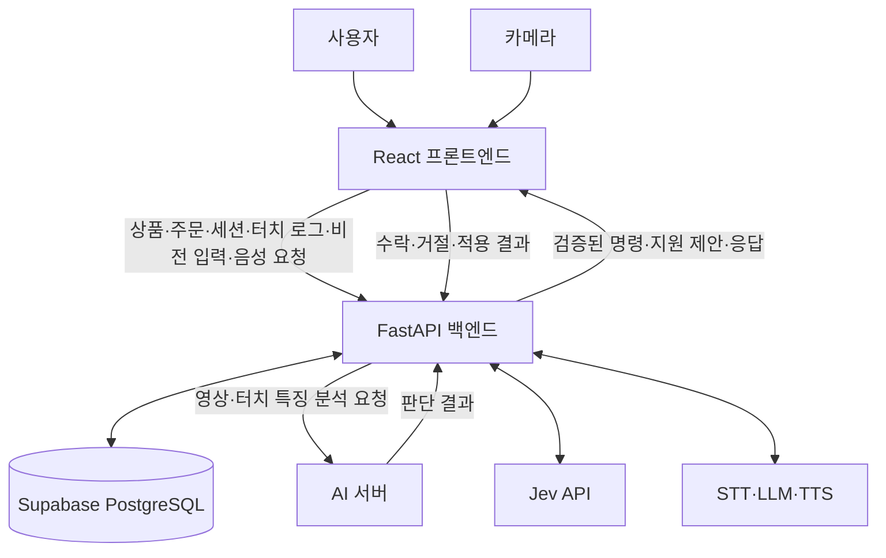

# AI 기반 적응형 매장 키오스크

컴퓨터 비전과 터치 통계를 활용해 사용 상황을 파악하고, Jev가 적절한 접근성 지원을 선택하는 소형 매장 주문 키오스크입니다.

사용자는 터치 또는 음성으로 상품을 주문할 수 있으며, 이용 중 큰 글씨·큰 버튼·낮은 화면·단계별 안내 등의 지원을 받을 수 있습니다.

> 현재 설계 및 개발 단계입니다. 아래 구조와 기능은 목표 구성이며, 세부 기술과 구현 범위는 실험 결과에 따라 조정합니다.

처음 읽는 분께: ① 프로젝트가 무엇인지는 이 문서의 '프로젝트 목표'와 '시스템 아키텍처', ② 지금 어디까지 됐는지는 '현재 구현 상태' 표(날짜·담당·문서 링크), ③ 다음 날짜는 '일정', ④ 낯선 말은 '용어'를 보세요. 부분별 세부 상태는 각 폴더의 README이고, 팀 검토 문서는 `docs/*-Review.md`·`docs/*-Implementation.md`, 인터페이스 형식과 합의 상태는 `contract/`에서 확인합니다(음성 명세와 신규 주문 API는 팀 검토용 초안).

## 현재 구현 상태 (2026-10-12 기준)

| 부분 | 담당(GitHub) | 상태 | 자세한 문서 |
|---|---|---|---|
| 프론트엔드 | dudwlghkd | 샘플 상품·장바구니·모의 주문 화면, 수동 접근성 설정, 로컬 터치 기록을 구현했습니다(PR #17 · #19). 서버 주문 API 응답을 처리하는 프론트 흐름을 준비했습니다(PR #33, 2026-10-12 병합). 서버 쪽 상품·장바구니·주문 API는 구현 대기입니다 | `frontend/README.md` |
| 백엔드·DB | bb-cloud-create | 연결 확인·임시 세션·특징 전송 API를 구현했습니다(메모리 세션). 상품·장바구니·주문 API는 구현 대기입니다. Supabase 첫 마이그레이션을 적용했습니다(2026-10-07) | `backend/README.md`, `db/README.md` |
| AI 서버·음성·Jev | jiwon-L-ee | `/v1/analyze`는 명세 예시 값을 돌려주는 자리 표시입니다. backend의 음성 해석 API(대화 맥락 해석 → MCP 장바구니 도구 입력 생성)를 병합했습니다(PR #36, 2026-10-13). frontend 음성 입력(Chrome 인식을 짧게 여닫기)·잡담 거르기(`ignored`)·주문 메뉴 연결은 PR #42에서 검토 중이고, MCP 도구 실행은 남았습니다. Jev는 아직 연동하지 않았습니다 | `ai-server/README.md`, `docs/Voice-MCP-Implementation.md` |
| 컴퓨터 비전 | wdragon92 | 관측 뼈대(PR #32, 2026-10-10)와 상황 태그 3개의 규칙 · 출력 형식(PR #35, 2026-10-12)을 병합했습니다. 기준값은 모두 `[파일럿]`이고, 실행기 · 서버 연결은 없습니다. 학교 GPU 서버에서 머리 탐지기를 학습했습니다(2026-10-12 끝) | `ai-server/app/modules/vision/README.md` |
| 인프라 | bb-cloud-create | EC2 템플릿을 검증했습니다(PR #31). 스택은 비용 승인 전이라 만들지 않았습니다 | `infra/aws/README.md` |

상태어: 구현됨 / 준비됨(서버 미연결) / 자리 표시 / 제안(팀 검토 전) / 보류 / 미정. 이 표에서는 이 여섯 말을 이 뜻으로만 씁니다.

프론트엔드는 OpenAPI 0.3.0 초안에 맞춰 서버 응답을 사용하는 상품·장바구니·모의 주문 화면을 준비했습니다. 실제 주문 API 연결 완료와 팀 전체 합의는 아직 확인되지 않았습니다.

- 서버 상품의 분류·가격·온도·판매 가능 여부 표시
- 성공 응답 후 장바구니 수량·금액 확정 표시, 요청 중 변경 차단
- 버전 충돌 시 최신 장바구니 표시, 응답 유실 시 같은 키·본문으로 수동 재시도
- 주문 성공 응답의 주문번호 표시, 새 주문·새로고침 시 새 서버 세션 요청
- 새 주문·새로고침에도 접근성 설정만 로컬 유지, ‘기본 화면’으로 수동 초기화
- 큰 글씨·큰 버튼·간편 화면·단계별 안내, 화면 하단의 주문 진행 버튼
- 로컬 터치·상호작용 기록에 서버 세션 ID 연결, 새 서버 세션·새로고침의 로그 세션 분리; 서버 통계 전송·AI 자동 지원은 미연결

터치 원시 기록은 주문 화면에서 로컬로 수집합니다. 백엔드에는 상태·연결 확인, 임시 세션 생성, 특징 전송이 구현돼 있고 상품·Cart·Order 서버 API는 구현 대기입니다. 주문 API가 없는 서버에서는 연결 대기를 표시합니다. 브라우저 테스트는 미리 준비한 HTTP 응답으로 프론트 동작을 검증하며 서버 구현을 대신하지 않습니다.

첫 시연에 필수가 아닌 완료 화면 복원·서버 재시작 후 보관·장기 보관·정밀 만료·동적 가격 변경은 후순위입니다. 공개 환경의 세션 접근 정책과 수량·버전·중복 요청 처리는 담당자 리뷰와 팀 합의가 필요합니다. 주문 UI의 새 주문·설정 유지 방향은 프론트 담당자의 검토 결과이며 팀의 최종 세션 정책과 구분합니다. 터치 통계 계산·서버 전송, 비전 수집, 음성·MCP, AI·Jev 기반 자동 지원, 실제 결제·재고 차감은 아직 연결하지 않았습니다.

## 프로젝트 목표

- 사용자가 접근성 설정을 직접 찾기 어려운 상황에서 필요한 지원을 제안합니다.
- 터치와 음성 간 전환, UI 설정 변경 시에도 주문 내용을 유지합니다.
- 터치 통계와 비전 정보의 활용 효과를 평가합니다.
- 규칙 기반 방식과 Jev의 지원 선택을 비교해 사용성 개선 여부를 확인합니다.

## 주요 기능

### 상품 주문

- 상품 목록과 분류 탐색
- 상품 옵션·수량 선택
- 장바구니 추가·수정·삭제
- 주문 확인 및 모의 결제
- 주문번호 표시

### 적응형 UI 지원

- 큰 글씨
- 큰 버튼
- 간편 화면
- 낮은 화면
- 높은 화면
- 단계별 안내
- 음성 안내
- 음성 조작
- 기존 화면으로 복귀

낮은 화면·높은 화면은 아직 `contract/`의 프리셋에 없습니다. 넣을지는 팀에서 정합니다.

자동 지원은 기본적으로 `상황 관찰 → 지원 제안 → 사용자 수락 → 적용` 순서로 진행합니다. 사용자가 직접 지원을 선택하거나 해제하는 기능도 제공합니다.

### 음성 인터페이스

음성으로 주문과 UI 설정을 조작합니다.

| 발화 예시 | 처리 |
|---|---|
| “아이스 아메리카노 하나 담아줘” | 상품·옵션·수량 확인 후 장바구니 반영 |
| “샌드위치 두 개로 바꿔줘” | 주문 항목의 수량 변경 |
| “글씨가 작아” | 글자 확대 의도로 해석 |
| “화면 좀 내려줘” | 낮은 화면 요청 처리 |
| “어떻게 해야 해?” | 현재 단계 안내 |

대상이나 옵션이 불분명하면 확인 질문을 합니다. 명확한 사용자 요청은 자동 지원 판단을 기다리지 않고 검증 후 처리합니다.

## 시스템 아키텍처



### 구성별 책임

| 구성 | 역할 |
|---|---|
| 프론트엔드 | 주문 화면, 접근성 UI, 터치 기록, 음성 녹음·재생 |
| 백엔드 | 주문·세션 관리, DB 저장, 터치 통계 계산, AI 서버·외부 AI API(STT·LLM·Jev) 연동, 지원 선택, 명령 검증 |
| AI 서버 | 자체 모델 추론: 비전 특징 추출(카메라 분석, 객체 검출, 얼굴·자세 특징), 불편 상태 판단 |
| Supabase | PostgreSQL 데이터 저장 |

AI 서버는 판단 결과를 반환하고, 백엔드가 지원을 선택해 적용 조건을 검증합니다. 음성 명령에 따른 주문 변경도 백엔드가 검증합니다. 프론트엔드는 실제 UI 적용 결과를 다시 전달합니다.

터치 통계의 계산 위치는 아직 팀 검토 항목입니다. 이 README는 백엔드 계산으로, `contract/frontend-backend.openapi.yaml`의 `TouchFeatures`는 프론트엔드 계산으로 적혀 있습니다(`docs/Touch-Log-Review.md` 5장 T12).

비전 추론의 처리 위치는 아직 정하지 않았습니다. 이 README의 구조도는 AI 서버에서 처리하는 구성으로 그려져 있고, 비전 모듈 README는 처리 위치를 미정으로 설명합니다. 이 차이는 2026-10-14 팀 회의에서 정합니다. 프론트엔드 ↔ 백엔드 명세 0.3.0은 기존 0.1.0의 터치 통계·비전 특징 전송 형식을 유지합니다. 비전 학습 코드의 최종 저장 위치는 팀에서 별도로 정합니다.

비전 담당은 관측값을 키오스크 PC에서 계산하고 서버에는 값만 보내는 구성을 제안했고(2026-10-08), 처리 위치는 2026-10-14 팀 회의에서 정합니다. 현재 계약의 `FeatureWindowRequest.vision`은 프론트엔드가 보내는 형식이고, 비전 모듈(`ai-server/app/modules/vision/README.md`)은 두 경로 모두 전제하지 않습니다.

## 데이터 처리 흐름

### 자동 지원

1. 프론트엔드가 터치·화면 이동·실행 결과를 기록합니다.
2. 비전 모듈이 같은 세션의 관측값을 추출합니다(처리 위치는 팀 회의에서 정합니다).
3. 시간 구간별 터치 통계와 비전 정보를 결합합니다. 결합 위치는 `contract/`에서 정합니다.
4. AI 서버가 결합된 정보로 불편 상태를 판단합니다.
5. 백엔드가 판단 결과, 현재 화면, 지원 이력을 바탕으로 규칙 또는 Jev로 지원을 선택합니다.
6. 백엔드가 최신 화면과 적용 조건을 확인합니다.
7. 프론트엔드가 지원을 제안하고, 수락 시 적용합니다.
8. 사용자 반응과 적용 이후 행동을 저장합니다.

### 음성 처리

```text
음성 녹음
→ 백엔드
→ STT(Whisper)
→ LLM의 주문·UI 변경 의도 해석
→ 백엔드 명령 검증
→ 주문 상태 또는 UI 변경
→ 화면·음성 응답
```

위 흐름은 수행계획서 기준입니다. 현재 구현은 Chrome 내장 인식(Web Speech API)으로 텍스트만 보내고 Whisper·녹음 전송은 쓰지 않습니다(PR #36). 수행계획서와 달라진 점은 멘토·팀 공유가 남았습니다(`docs/Voice-MCP-Implementation.md`).

### 지원 결과 피드백

```text
지원 선택 → 사용자 반응 → 실제 적용 → 이후 행동 관찰
    ↑                                      ↓
    └──────── 이전 지원 결과를 다음 판단에 반영 ────────┘
```

실험 이후에는 오류 원인에 따라 비전 모델, Jev 지침·입력, UI를 각각 개선합니다. 이 과정이 Jev 자체의 자동 학습이나 전체 시스템의 역전파 학습을 의미하지는 않습니다.

## 데이터와 모델의 역할

### 터치 로그

터치 정보는 별도의 모델을 학습하지 않고 코드로 통계를 계산합니다.

- 전체 누름 횟수
- 버튼 밖 입력 횟수·비율
- 실행 성공·차단·시스템 오류
- 반복 입력과 실패 후 재시도
- 화면별 체류 시간
- 뒤로가기·화면 왕복
- 마지막 성공한 조작 이후 경과 시간

버튼 밖 입력이나 긴 체류를 곧바로 불편으로 확정하지 않습니다. 습관적인 배경 터치, 정상적인 상품 비교, 서버 대기 상황을 함께 고려합니다.

### 컴퓨터 비전

직접 모델을 학습·파인튜닝하는 범위는 컴퓨터 비전입니다.

관측값(구현, `ai-server/app/modules/vision/`): 얼굴 · 몸 보임/못 봄, 얼굴 크기 변화(눈 사이 거리, 세션 시작 대비 비율), 영상 안 얼굴 위치, 고개 방향(yaw · pitch · roll), 추적 연속(보인 구간 · 못 본 시간), 얼굴 수(검출기), 측정 신뢰도 재료(검출 점수 · 몸 점 가시도 · 밝기 · 선명도).

보조기구 검출: 비전 담당 방향(2026-10-08)은 목발만 검토하고 휠체어 · 보행기는 보류입니다. 목발 탐지기는 공개 학습 상자가 적어(Open Images 'Crutch' 85장 · 상자 140개) 아직 학습하지 않았습니다.

특징은 실제 촬영 환경에서 검증한 뒤 채택합니다. 객체 유무만으로 사용자의 조작 능력이나 지원 선호를 단정하지 않습니다.

현재 범위(비전 담당, 2026-10-10 기준): 바싹 다가옴·화면 앞에 남음·새 손님 장면의 관측과, 같은 관측에서 계산하는 상황 태그 후보 3개(뒤에 기다리는 사람 신경 씀·일행과 상의 중·두리번거림)를 먼저 구현합니다. 태그 이름과 화면 표시 문구는 `ai-server/app/modules/vision/README.md`의 표에 있습니다. 태그의 시간 창·횟수 기준값은 팀 촬영 파일럿의 분포에서 정하며 그 전에는 넣지 않습니다. 보조기구 탐지는 목발만 후보로 두고 휠체어·보행기는 보류합니다(2026-10-08). 관측값은 키오스크 PC에서 계산하고 서버에는 값만 보내는 방향이며, 처리 위치는 2026-10-14 팀 회의에서 정합니다.

### Jev

Jev에는 다음 정보를 전달합니다.

- AI 서버의 판단 결과
- 계산된 터치 통계
- 비전 특징과 측정 유효성
- 현재 화면과 UI 설정
- 이전 지원과 사용자 반응
- 판단 지침과 허용된 선택지

횟수·비율·시간 계산과 필수 적용 조건은 코드로 처리합니다. Jev의 판단 적합성은 프로젝트 실험으로 검증합니다.

## 기술 스택

| 영역 | 기술 | 상태 |
|---|---|---|
| 프론트엔드 | React, Vite, TypeScript | 주문 API 응답 처리·수동 접근성 UI 준비 |
| 백엔드 | Python, FastAPI | 연결·임시 세션 API 구현, 주문 API 대기 |
| AI 서버 | Python, FastAPI | 초기 실행 환경 구현(판단은 명세 예시 값을 돌려주는 자리 표시) |
| 데이터베이스 | Supabase PostgreSQL | RDS에서 변경 |
| 영상 처리 | OpenCV | 비전 모듈에서 사용(입력 읽기, 밝기·선명도 계산, 그리기, PR #32) |
| 얼굴·자세 특징 | MediaPipe 0.10.33 | 비전 모듈 추론 3종(Face Landmarker·Face Detector·Pose Landmarker lite) 구현. 판정 규칙·서버 연결은 없음 |
| 객체 탐지 | YOLOX-Nano(Apache-2.0, 후보) | 머리 탐지기 학습 끝(2026-10-12, 학교 GPU 서버. 숫자는 발표 자료에서). 저장소에는 없음. 보조기구 탐지는 보류 |
| 비전 모델 학습 | PyTorch | 학교 GPU 서버에 학습 환경 구성. 학습 코드의 저장 위치는 팀에서 정하고 가중치는 Git에 올리지 않음(AGENTS.md). 내보낸 모델의 CPU(ONNX) 실행 검증은 후속 작업 |
| 음성 녹음 | Web MediaRecorder API | 쓰지 않음. Chrome 인식만 쓰고 녹음 파일을 서버로 보내지 않음(PR #36, 멘토·팀 공유 전) |
| STT | Chrome 내장 인식(Web Speech API) | 구현(PR #42, `frontend/src/features/voice/`). 수행계획서의 OpenAI Whisper는 쓰지 않으며 예비 경로도 뺌(PR #36, 멘토·팀 공유 전) |
| 음성 의도 해석 | LLM API | 모델 미정 |
| TTS | 미정 | 기술 선정 예정 |
| 지원 선택 | Jev API, 규칙 기반 선택기 | 비교 평가 |
| 실시간 전달 | SSE 또는 WebSocket | 지원 제안·상태 전달. `docs/Voice-MCP-Implementation.md` 3.4는 SSE를 제안(팀 검토 전) |
| 컨테이너 | Docker, Docker Compose | 실행 환경 구성 |
| 배포 | AWS EC2, AWS Amplify | 제안 구성 |
| 버전 관리 | Git, GitHub | 협업 |
| 문서 관리 | Markdown, Notion | 설계·회의 기록 |

스토리지와 큐 기술은 필요성이 확인되면 선택합니다. 폴더가 있다는 이유만으로 S3·R2·Redis 등을 모두 도입하지 않습니다.

## 저장소 구조

아래는 목표 구조입니다. 기존 폴더의 대소문자와 실제 파일 구성은 정리 과정에서 맞춥니다.

```text
Capstone-design/
├── frontend/
│   ├── src/
│   │   ├── app/
│   │   │   ├── App.tsx
│   │   │   ├── router.tsx
│   │   │   ├── providers.tsx
│   │   │   └── layouts/
│   │   ├── features/
│   │   │   └── <feature>/
│   │   │       ├── api/
│   │   │       ├── components/
│   │   │       ├── hook/
│   │   │       ├── types/
│   │   │       ├── utils/
│   │   │       ├── pages/
│   │   │       └── index.ts
│   │   └── shared/
│   │       ├── components/
│   │       ├── api/
│   │       ├── hook/
│   │       ├── type/
│   │       └── utils/
│   ├── public/
│   ├── package.json
│   ├── tsconfig.json
│   └── Dockerfile
│
├── backend/
│   ├── app/
│   │   ├── main.py
│   │   ├── modules/
│   │   │   └── <module>/
│   │   │       ├── router.py
│   │   │       ├── service.py
│   │   │       ├── repository.py
│   │   │       ├── schemas.py
│   │   │       ├── models.py
│   │   │       ├── exceptions.py
│   │   │       ├── tests/
│   │   │       └── __init__.py
│   │   ├── infrastructure/
│   │   │   ├── database/
│   │   │   ├── storage/
│   │   │   ├── queue/
│   │   │   └── external/
│   │   └── common/
│   │       ├── config/
│   │       ├── exceptions/
│   │       ├── utils/
│   │       └── constants/
│   ├── requirements.txt
│   └── Dockerfile
│
├── ai-server/
│   ├── app/
│   │   ├── main.py
│   │   ├── modules/
│   │   │   └── <module>/
│   │   ├── inference/
│   │   ├── infrastructure/
│   │   └── common/
│   ├── requirements.txt
│   └── Dockerfile
│
├── db/
│   ├── migration/
│   ├── schema/
│   └── seed/
├── contract/
├── docs/
├── infra/
├── docker-compose.yml
└── README.md
```

### 디렉터리 설명

| 경로 | 역할 |
|---|---|
| `frontend/src/app` | 앱 진입점, 라우팅, 전역 Provider 연결, 레이아웃 |
| `frontend/src/features` | 상품·장바구니·접근성·음성 등 기능별 구현 |
| `frontend/src/shared` | 여러 기능에서 사용하는 공통 UI·API·도구 |
| `backend/app/modules` | 업무별 API·서비스·저장 로직 |
| `backend/app/infrastructure` | DB·스토리지·외부 서비스 연결 |
| `backend/app/common` | 공통 설정·예외·상수 |
| `ai-server/app/modules` | 비전 특징 추출·불편 상태 판단 |
| `ai-server/app/inference` | 직접 실행하는 모델의 로딩·추론 코드 |
| `db` | DB 변경 이력, 구조, 초기 데이터 |
| `contract` | API·이벤트·AI 명령 형식과 예시 |
| `docs` | 시나리오·설계·실험·회의 문서 |
| `infra` | 배포·운영 설정 |

필요한 파일부터 추가하며, 모든 기능에 빈 폴더나 동일한 파일 구성을 강제하지 않습니다.

## API 및 데이터 계약

프론트·백엔드·비전·AI 담당자는 구현 전에 `contract/`에서 다음 형식을 합의합니다.

- 세션 생성과 종료
- 상품·옵션·주문
- 터치·화면·실행 이벤트
- 비전 특징과 측정 유효성
- 지원 판단 요청·응답
- 지원 수락·거절·적용 결과
- 음성 요청과 구조화된 명령

시간 정보는 관측 시각과 서버 수신 시각을 구분합니다. 같은 세션·화면 방문·배치 버전의 정보를 연결하고, 오래된 판단 결과는 적용하지 않습니다.

현재 명세 파일:

- [`contract/frontend-backend.openapi.yaml`](contract/frontend-backend.openapi.yaml): 프론트엔드 ↔ 백엔드 0.3.0. 기존 네 API 형식 유지 및 상품·장바구니·모의 주문 API 초안 추가
- [`contract/backend-ai.openapi.yaml`](contract/backend-ai.openapi.yaml): 백엔드 ↔ AI 서버
- [`contract/voice.openapi.yaml`](contract/voice.openapi.yaml): 프론트엔드 ↔ 백엔드 음성 요청. 팀 검토 전 제안(판 번호는 파일의 `info.version`)

신규 주문 API 6개는 `x-contract-status: draft`로 표시한 팀 검토용 명세입니다. 설계 이유·미정 정책은 [`docs/Product-Cart-Order-API-Draft.md`](docs/Product-Cart-Order-API-Draft.md)에 기록합니다. 명세 반영은 서버 구현이나 실제 주문·결제 연결 완료를 의미하지 않습니다. 프론트 호출 함수·타입·화면은 초안에 맞춰 준비했으며 `x-frontend-status: prepared`, 서버 주문 API는 `x-backend-status: pending`으로 구분합니다. 팀 검토 후 백엔드 라우터·서비스·저장소와 상품 데이터를 구현하고 실제 요청·응답으로 프론트를 검증합니다. 구체적인 담당자·일정은 팀에서 정하고 PR에 기록합니다.

## 역할 분담

| 담당 | 주요 업무 |
|---|---|
| 프론트엔드 | 주문·접근성 UI, 터치 로그, 녹음·재생, 상태 유지 |
| 백엔드 | 세션·주문·DB, 터치 통계, AI 연동, 명령 검증 |
| 컴퓨터 비전 | 촬영 환경, 데이터 라벨링, 모델 학습·평가, 관측값 추출과 상황 태그(근거 동봉) 제안. 지원 선택은 판단 층 |
| AI | STT·LLM·TTS, 음성 대화, Jev 지침·선택 로직, 판단 평가 |

역할 구분과 서버 구분은 동일하지 않습니다. 배포 위치와 실행 방식은 데이터 접근과 처리 성능을 기준으로 결정합니다.

## 개발 순서

1. 주문 범위와 실제 화면·카메라 환경 확정
2. 기본 주문과 수동 접근성 기능 구현
3. 공통 데이터 계약과 세션·로그 저장 구현
4. 터치 통계와 비전 특징 수집
5. 음성 주문·UI 변경 명령 연결
6. 규칙·Jev 지원 선택 및 사용자 응답 연결
7. 파일럿으로 지침·주기·적용 조건 조정
8. 조건을 고정하고 사용자 비교 실험
9. 결과 분석 및 안정화

## 일정

수업(컴퓨터학부 종합설계프로젝트1) 일정(수업 OT 자료 p.6, "예정(변동 가능)"): 중간발표1 2026-10-12, 중간발표2 2026-11-02, 중간발표3 2026-11-23, 최종발표 2026-12-07, 산학협력프로젝트 경진대회 2026-12-21, 결과보고서 및 실적 제출 2026-12-23. 학회 논문(UCWIT 2026, 학회 2026-11-27\~28)의 제출 마감은 2026-11-05입니다(학회 모집 안내 기준. 제출 정보 양식 파일에는 11-12로 적혀 있어 확인 중).

위밋(산학 멘토링) 제출: 중간보고서 2026-10-16, 2차 멘토링 보고서 2026-11-06, 3차 2026-12-04, 결과보고서 및 발표자료 2026-12-11 (위밋 소개자료 p.7).

중간발표 자료에 들어가는 항목: 수행배경 및 목표, 전체 시스템 구조, 시스템 모델링 및 설계, 진행상황(기술스택 기반), 이슈사항 및 해결방안, 향후일정 (OT p.8). 발표자는 팀원이 번갈아 맡습니다(OT p.3). 2026-11-02 중간발표2의 발표자는 비전 담당입니다.

## 평가 계획

- 터치 정보만 사용하는 조건과 비전을 추가한 조건 비교
- 동일한 지원 기능에서 규칙 기반과 Jev 기반 선택 비교
- 과업 성공률과 완료 시간
- 입력 실패와 불필요한 지원 제안
- 지원 수락·거절·되돌리기
- 판단 지연과 호출 비용

개발용 파일럿과 최종 평가 데이터를 분리합니다. 지원 수락이나 적용 직후 수치 변화만으로 효과를 확정하지 않고 대조 조건과 함께 평가합니다.

## 실행 안내

프론트엔드는 로컬 개발 서버(`pnpm dev`)나 루트 `docker-compose.yml`의 `frontend` 서비스로 실행합니다. Compose에는 frontend·backend·ai-server 세 서비스가 있습니다.

서비스별 상세 안내는 [`frontend/README.md`](frontend/README.md), [`backend/README.md`](backend/README.md), [`ai-server/README.md`](ai-server/README.md)를 참고합니다.

### 프론트엔드 주문 화면

Node.js 22.18 이상과 pnpm이 필요합니다. 저장소 루트에서 실행합니다.

```sh
cd frontend
pnpm install
pnpm dev
```

터미널에 표시되는 로컬 주소로 접속합니다. 기본 API 모드의 전체 주문 흐름에는 상품·Cart·Order API가 구현된 백엔드가 필요합니다. 서버 없이 시연하려면 [명시적인 개발 샘플 모드](frontend/src/features/order/README.md#개발용-샘플-모드)를 켭니다. 고정 응답을 이용한 [브라우저 검증 방법](frontend/src/features/order/README.md#백엔드-없이-화면-검증)도 제공합니다.

빌드·테스트와 상세 안내는 [프론트엔드 README](frontend/README.md)를 참고합니다.

### 백엔드·AI 서버 및 통합 실행

Docker Desktop의 Linux 컨테이너 엔진을 실행한 뒤 저장소 루트에서 사용합니다.

```powershell
docker compose up --build
```

백엔드 상태는 http://127.0.0.1:8000/health 에서 확인합니다. 이 응답은 백엔드 프로세스 상태만 나타내며 AI 서버나 DB 연결을 보장하지 않습니다. AI 서버는 호스트 포트를 공개하지 않고, 백엔드가 Docker 네트워크의 `http://ai-server:8001`로 호출합니다.

Compose 이미지에는 `backend/.env`를 복사하지 않으며 현재 Compose에도 `env_file` 설정이 없습니다. 필요한 환경변수는 Compose의 `environment` 등 실행 환경에서 주입합니다. 루트 `.env`를 Compose 변수 치환에 사용하는 것과 컨테이너에 값을 전달하는 것은 별개입니다.

기존 연결 API 검증 기록은 [PR #26](https://github.com/knu-capstone-design-06/Capstone-design-project/pull/26)를 참고합니다. 상품·장바구니·주문 API의 통합 검증은 백엔드 구현 후 별도로 수행합니다.

Compose의 frontend는 Nginx의 `/backend/` 프록시로 backend를 호출합니다([프론트엔드 README](frontend/README.md#docker-실행과-백엔드-연결)). 연결 확인·세션 생성·특징 전송은 backend에 구현돼 있으며, 상품·장바구니·모의 주문과 세 서비스의 전체 기능 연동은 구현·검증 대기입니다.

- API 키와 DB 자격 증명은 저장소에 커밋하지 않습니다.
- `.env.example`에는 실제 비밀값 없이 필요한 항목을 문서화합니다.
- 서비스 간 연결 주소와 설정은 환경변수로 관리합니다.
- 상품·장바구니·주문 API의 실제 서버 연동은 구현·검증 대기입니다.

## 용어

- Jev: 외부 판단 API(https://docs.typesafe.ai). 백엔드가 호출하며, 연동 전에는 응답의 `decided_by`가 `rule_placeholder`입니다.
- 판단 층: 관측값·상황 태그·터치 통계를 받아 지원을 고르는 쪽(규칙 + Jev).
- 상황 태그: 한 시간 창의 관측값이 가리키는 상황의 이름과 그 근거. 상황 태그만으로 지원을 적용하지 않고, 판단 층이 터치 통계와 현재 화면을 함께 보고 지원을 고릅니다.
- G10: 전시 대상 키오스크 PC(32인치 1080×1920 세로 화면, 카메라 2대). 처리 시간은 아직 재지 않았습니다.
- AI(Decision AI) 담당: 음성·LLM·Jev·판단 층. 수행계획서의 역할 이름이 Decision AI입니다.
- [파일럿]: 출처가 없어 파일럿 데이터로 정할 값. "기준 없음"은 아직 정할 수 없다는 뜻입니다.

## 참고 자료
- [Jev 공식 문서](https://docs.typesafe.ai/introduction)
