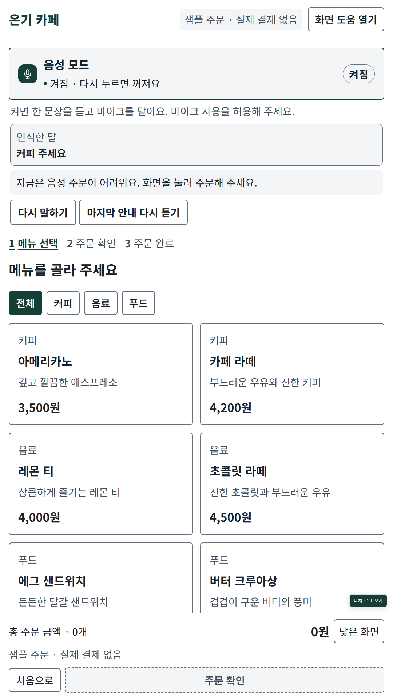

# 음성 응답 자동 읽기 화면 검증

2026-11-06 `TTS` 브랜치를 Windows Chrome headless의 1080×1920 뷰포트에서 확인했습니다. `voiceMode.browser.test.mjs`의 고정 HTTP 응답·모의 음성 인식·모의 음성 합성을 사용한 화면입니다. 실제 마이크·스피커·OpenAI·G10 검증은 포함하지 않습니다.

| 화면 | 확인한 상태 |
| --- | --- |
| [기본 화면의 질문 읽기](tts-question-normal.png) | 서버의 확인 질문과 ‘안내를 읽고 있어요’, ‘안내 중단’ 버튼을 표시합니다. 질문을 읽는 동안 마이크와 ‘다시 말하기’는 열리지 않습니다. |
| [큰 글씨·큰 버튼·낮은 화면](tts-question-low-large.png) | 같은 질문을 200% 큰 글씨·큰 버튼·낮은 화면에서 표시합니다. 내부 스크롤로 ‘안내 중단’ 버튼에 접근한 상태이며 화면 폭을 넘지 않습니다. |

질문 재생 완료 뒤 재청취, 수동 화면 읽기와의 전환, 안내 중단·재생 실패·페이지 이탈 시 재생 취소를 함께 검사했습니다. 브라우저 검사 두 파일(`voiceMode.browser.test.mjs`, `accessibility.browser.test.mjs`)은 하위 검사 포함 21개 통과했고, 별도 개발 샘플 서버를 요구하는 검사 1개는 건너뛰었습니다. 단위 테스트 111개·TypeScript/Vite 빌드도 통과했습니다.

이미지는 소리나 실제 음성 인식 품질을 증명하지 않습니다. G10에서 Windows·브라우저 배율 100%와 F11 전체 화면으로 한국어 음성 설치·스피커·마이크 재유입을 최종 확인해야 합니다.

## 2026-11-13 PR #79 변경 요청 반영 검증

PR head `76a2a34`에서 최신 main `9b9828c`를 `TTS` 브랜치에 merge한 뒤 검증했습니다. 이전 화면과 결과는 위의 2026-11-06 기록입니다.

| 화면 | 확인한 상태 |
| --- | --- |
| [질문과 실패 안내](review-question-failure.png) | 확인 질문을 유지하면서 실패 응답의 `reply_text`를 별도로 표시합니다. 읽는 문장과 화면 문장이 일치합니다. |
| [마지막 안내 다시 듣기](review-replay.png) | 중단·완료 뒤 ‘마지막 안내 다시 듣기’를 ‘다시 말하기’와 별도로 제공합니다. 마이크 종료 뒤 읽고, 완료 후 자동으로 마이크를 열지 않습니다. |
| [낮은 화면·큰 글씨·큰 버튼](review-low-large.png) | 읽기가 시작되면 중단 버튼을 보이는 영역으로 옮깁니다. 테스트의 사전 스크롤 없이 버튼 중앙의 최상위 요소가 중단 버튼인지 검사합니다. |

- `pnpm test`: 116개 통과(기존 111개 + 컨트롤러 회귀 검사 5개).
- `pnpm build`: TypeScript·Vite 빌드 통과.
- `voiceMode.browser.test.mjs`: 20개 통과, 생략 없음. 기본 API 모드와 별도 개발 샘플 서버를 함께 사용했습니다.
- `accessibility.browser.test.mjs`: 하위 검사 포함 11개 통과.
- `git diff --check`: 통과.

기본·낮은 화면·큰 글씨·큰 글씨와 큰 버튼·낮은 화면과 큰 글씨·낮은 화면과 큰 글씨와 큰 버튼·전체 설정의 7개 조합을 1080×1920 Chrome headless에서 확인했습니다. 옵션 창을 읽기 중 또는 서버 처리 중에 열어도 자동 읽기·재청취가 시작되지 않으며, 창을 닫은 뒤 수동으로 마지막 안내를 다시 들을 수 있습니다. 실패 안내를 다시 듣는 도중에도 질문과 실패 문장을 함께 표시합니다. HTTP 실패에는 기존 기본 문구를 사용합니다.

고정 HTTP 응답·모의 음성 인식·모의 음성 합성을 사용하는 프론트 검증입니다. 실제 backend·OpenAI·마이크·스피커·G10 F11 검증은 수행하지 않았습니다. 첫 응답의 음성 목록 로딩 관련 비차단 권고는 이번 수정에 포함하지 않았습니다. #72·#70의 겹치는 파일은 병합 순서 합의와 통합 재검증이 여전히 필요합니다.

## 2026-11-17 후속 권고 반영

최신 main `b3afa6f`를 반영하고 PR #79의 비차단 권고 두 가지를 보완했습니다.

서버 실패 뒤 ‘다시 말하기’로 마이크를 열고 ‘마지막 안내 다시 듣기’로 전환한 다음 재생이 끝난 상태입니다. 읽었던 서버 문장이 화면에 남고, 주문 요청이나 자동 재청취가 추가로 실행되지 않음을 확인했습니다.

- 촬영: Windows 개발 PC, Edge headless, 1080×1920, device scale factor 1. 고정 HTTP 응답·모의 음성 인식·모의 음성 합성을 사용했습니다. 실제 장비의 Windows 배율·F11·음향 검증과 구분합니다.
- Windows Node.js 24.22.1 단위 테스트 119개 통과. 늦은 음성 목록의 로컬 음성 선택, 목록 대기 중 취소·전체 시간 초과, 목록 미도착 시 기본 음성 사용을 포함합니다.
- TypeScript·Vite 빌드와 `git diff --check` 통과.
- 음성 브라우저 검사 20개 통과. 기본 API 모드와 개발 샘플 모드 모두 검사했고 생략은 없습니다. 기본·큰 글씨·큰 버튼·낮은 화면 등 7개 조합을 포함합니다.
- 접근성 브라우저 검사는 처음에 새 세션 ID만 기다리고 Cart 조회 완료 전에 검증하는 사례 1개가 실패했습니다. 주문 준비 표시가 사라질 때까지 기다리도록 보완한 뒤 파일 전체를 다시 실행해 하위 검사 포함 11개가 모두 통과했습니다.
- 실제 브라우저의 설치 음성 목록 로딩·한국어 음향·마이크 재유입 및 실제 backend·OpenAI·G10 검증은 수행하지 않았습니다. 화면 지원 제안의 backend 연결은 이 PR의 변경 범위에 포함하지 않습니다.
