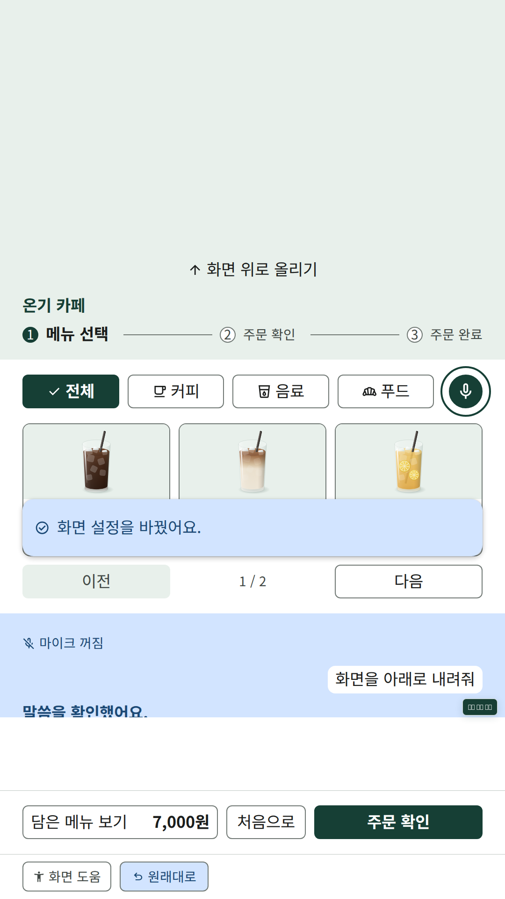
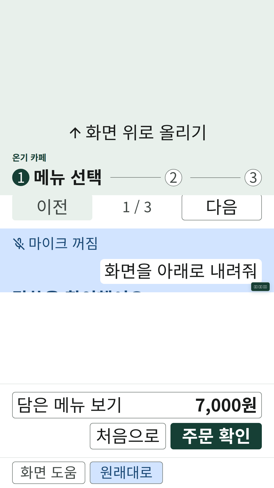

# 음성 화면 설정 프론트 적용부 검증

- 날짜: 2026-11-24
- 화면: 1080×1920 세로, Chromium headless, 브라우저 배율 100%
- 범위: 고정 HTTP 응답·모의 음성 인식/합성과 개발 전용 프론트 내부 값 주입
- 상태: 서버 UI 명령 계약·실제 음성 명령 생성·시험 기기 검증 전

두 화면 모두 Cart는 아메리카노 2개·7,000원으로 유지됩니다. 변경값은 영구 저장하지 않으며 [원래대로]로 음성 변경을 해제합니다. 큰 글씨·낮은 화면은 내부 스크롤로 음성 상태에 접근한 장면입니다.

| 화면 | 이미지 |
|---|---|
| 기본 글씨·낮은 화면 |  |
| 큰 글씨·큰 버튼·낮은 화면 |  |

새 단위 검사 12개·브라우저 검사 8개에서 설정의 켜기/끄기, Cart·수동 설정 유지, 복귀·초기화·새로고침, 모달·화면 이동·페이지 이탈·새 세션 뒤 지연 응답 폐기를 확인했습니다. 실제 마이크 → AI 해석 → 화면 설정 변경의 완료 기록은 아닙니다.

재현 방법과 백엔드·AI 요청 항목은 [프론트 적용부 문서](../../../frontend/src/features/order/voiceSettings.md)를 참고합니다.
