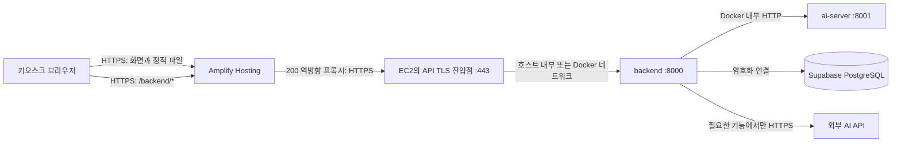

# 배포 위치와 통신 경로 제안

> 상태: 팀 검토 중 (2026-10-12). 프론트엔드·백엔드·AI 담당자의 리뷰와 팀 합의 전에는 확정 구성으로 취급하지 않습니다.

## 제안 구성

| 구성요소 | 운영 배포 위치 | 역할 |
| --- | --- | --- |
| `frontend/` | AWS Amplify Hosting | React/Vite 빌드 결과물(`dist/`) 제공, 브라우저의 HTTPS 진입점 |
| `backend/` | 서울 리전 AWS EC2의 backend 컨테이너 | 세션·주문 API, AI 결과 검증, DB 및 외부 API 호출 |
| `ai-server/` | backend와 동일한 EC2의 별도 컨테이너 | 백엔드가 요청하는 내부 추론 API |
| DB | 서울 리전 Supabase PostgreSQL | 백엔드가 관리하는 영속 데이터 |

루트 [`docker-compose.yml`](../docker-compose.yml)의 세 서비스 구성은 **로컬 통합 개발용**으로 유지합니다. 운영에서는 프론트엔드 컨테이너를 배포하지 않고 Amplify가 정적 파일을 제공합니다. 기존 [EC2 템플릿](aws/ec2-baseline.yaml)은 backend·ai-server용 호스트 준비 단계이며, 앱 배포·도메인·HTTPS를 아직 구성하지 않습니다.

## HTTP 통신 경로

1. 브라우저는 Amplify가 제공한 같은 출처의 `/backend/*`로 백엔드 요청을 보냅니다. Amplify의 200 역방향 프록시 규칙이 `/backend/<*>`를 `https://<API 도메인>/<*>`로 전달합니다. API 도메인과 유효한 TLS 인증서는 실제 배포 전에 마련해야 합니다. Amplify 역방향 프록시의 대상은 HTTPS여야 합니다.
2. EC2의 TLS 진입점은 요청을 backend의 8000 포트로 전달합니다. TLS 구현 방식(호스트 역방향 프록시 또는 별도 컨테이너)과 인증서 발급·갱신 방식은 배포 구현 PR에서 정합니다.
3. backend는 Docker 내부 주소 `http://ai-server:8001`로 AI 서버를 호출합니다. 브라우저는 AI 서버에 직접 요청하지 않습니다.
4. Supabase 연결 정보와 외부 AI API 비밀값은 백엔드 실행 환경에서만 관리합니다. 프론트엔드 빌드나 Git 저장소에 넣지 않습니다.

외부 수신 포트는 HTTPS 443을 기준으로 설계합니다. 8000·8001·SSH 22는 직접 공개하지 않습니다. HTTP 80의 사용 여부는 인증서 발급·리디렉션 방식이 정해질 때 결정합니다. 현재 EC2 템플릿의 보안 그룹에는 수신 규칙이 없으므로 배포 전 별도 변경이 필요합니다.

## 기존 코드와의 관계

- 프론트엔드 API 기본 경로는 `/backend/`입니다. 로컬 Vite와 프론트엔드 Docker의 Nginx는 각각 자체 프록시를 사용합니다. Amplify 배포 시에는 **Amplify의 재작성 규칙을 별도로 설정**해야 합니다. [프론트엔드 실행 안내](../frontend/README.md), [Nginx 설정](../frontend/nginx.conf.template), [Vite 설정](../frontend/vite.config.ts)
- 현재 backend의 세션·특징 전송 API는 준비돼 있지만 상품·장바구니·주문 API와 DB 연결은 대기 중입니다. 이 배포 구조 결정만으로 해당 기능이 완료되지는 않습니다. [백엔드 안내](../backend/README.md)
- 기존 `/health`는 프로세스 상태만 나타냅니다. 배포 후에는 프론트엔드 → 백엔드, 백엔드 → AI 서버, 백엔드 → DB를 각각 확인합니다.
- 실시간 전달(WebSocket 또는 SSE)이 최종 요구사항이면 Amplify 프록시를 통한 동작을 별도 검증하고, 지원되지 않는 경로는 HTTPS API의 직접 호출과 출처 허용 정책을 팀에서 결정합니다. 현재 HTTP API의 경로 확정과 실시간 통신 방식 결정은 분리합니다.

## 프론트엔드 담당자 리뷰 요청

아래 항목을 확인하고 PR 리뷰에 **가능 / 수정 필요 / 추가 결정 필요**로 남겨 주세요.

1. 운영 프론트엔드를 Amplify의 정적 Vite 빌드로 제공해도 되는지, `frontend/dist` 산출물과 monorepo 빌드 설정에 빠진 것이 없는지.
2. 현재 프론트의 `/backend/` API 기본 경로를 운영에서도 유지할 수 있는지. Amplify 규칙에서 접두사 제거 후 경로·쿼리·요청 본문·메서드가 백엔드에 정확히 도착해야 합니다.
3. 장바구니·주문 API의 `Idempotency-Key`, PATCH·DELETE, 오류 상태·`Retry-After`가 프록시를 거쳐도 필요한 형태로 전달되는지. 실제 백엔드 API가 구현된 뒤 통합 검증할 항목도 표시해 주세요.
4. SPA 화면 경로 재작성 규칙보다 `/backend/*` 프록시 규칙을 우선 적용할 수 있는지.
5. 실제 키오스크 브라우저에서 HTTPS 카메라·마이크 권한과 음성 기능을 사용할 수 있는지. WebSocket/SSE가 첫 배포에 꼭 필요한지도 알려 주세요.
6. 운영 빌드에서 개발 샘플 모드가 꺼지고, 현재 로컬 프록시 설정에만 의존하는 코드가 없는지.

## 다른 담당자 리뷰 요청 및 배포 전 조건

- **백엔드:** 프록시 뒤의 경로·헤더 처리, 세션 접근 정책, DB 접속 역할, 비밀값 주입 방식, 직접 포트 공개 여부를 검토합니다.
- **AI:** 동일 EC2에서 backend와 ai-server를 실행할 때 모델의 CPU·메모리 요구량과 2초 호출 타임아웃의 적합성을 확인합니다.
- **인프라:** 학교 AWS 계정의 비용 승인자·지원 한도, API 도메인·TLS 방식, 443 보안 그룹, SSM 접속, Docker Compose 설치·재부팅 자동 시작, 로그·백업·복구 절차를 정합니다. 비용 승인 전에는 EC2를 생성하지 않습니다.
- 리뷰 결과와 팀 결정 날짜를 PR에 기록하고, 합의가 끝나면 [루트 README](../README.md)와 [AWS 안내](aws/README.md)의 `제안`·`검토` 표현을 확정 구성에 맞게 갱신합니다. 공용 기존 문서의 수정은 영향받는 담당자 동의를 받은 뒤 별도 PR에서 수행합니다.

## 참고

- [프로젝트 시스템 아키텍처와 현재 구현 상태](../README.md)
- [로컬 Docker Compose](../docker-compose.yml)
- [AWS EC2 초기 호스트 준비](aws/README.md)
- [AWS Amplify 역방향 프록시 재작성 예시](https://docs.aws.amazon.com/amplify/latest/userguide/redirect-rewrite-examples.html#reverse-proxy-rewrite)
